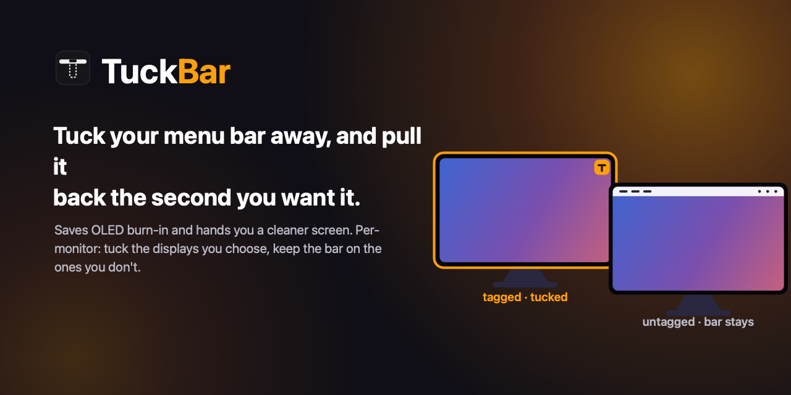

<p align="center">
  
</p>

# TuckBar

hide the macos menu bar on the displays you pick. it tucks the bar away so it stops burning into your oled, and brings it back the second you reach for it.

it's auto-hide the dock, but for the menu bar, and per-monitor. macos won't do that on its own. that's the whole reason this exists.

> v0.1, built in the open. issues and ideas welcome.

## why

the menu bar is bright, static, and always on. on an oled that's burn-in. on any screen it's clutter you don't need while you're working.

macos can auto-hide the menu bar, but only everywhere at once. tuckbar makes it per-display. tag your oled, tuck its bar, and your other monitor keeps its bar right where it is.

## the part macos won't do

there's no api to hide the menu bar on one display. so tuckbar does it the honest way: it covers the tagged display's menu-bar strip and fills it with that display's real wallpaper, captured live with screencapturekit. the bar doesn't go black, it just vanishes. the wallpaper runs clean to the top.

reach for the top edge and the cover steps aside so you can use the real bar. move away and it tucks back.

want max protection instead of seamless? flip the cover to solid black, pixels off. or drag the slider and just dim the bar.

> if the tagged display is your only screen there's nowhere to put the bar, so tuckbar falls back to the native auto-hide, same hover-to-reveal.

## what it does

- tag the displays you want tucked. the rest keep their bar.
- seamless wallpaper cover, solid black, or anywhere between on the dim slider.
- hover the top edge to get the real bar back, then it re-tucks.
- untuck for 5 to 60 minutes when you need the bar for a recording or a finicky app. it re-tucks itself.
- hide the dock too, optionally, while a tagged display is connected.
- tucks on connect, restores on unplug.
- lives in the menu bar, opens at login if you want, puts everything back when you quit.

## install

tiny swift package, no dependencies. build it:

```bash
git clone https://github.com/lelanddutcher/TuckBar.git
cd TuckBar
./scripts/build-app.sh
open build/TuckBar.app
```

drag `build/TuckBar.app` to /Applications if you want. it's ad-hoc signed right now, so the first launch needs a right-click then open to get past gatekeeper.

## permissions

- screen recording, for the seamless cover. it reads the wallpaper pixels behind the tagged display's menu bar, that's it. nothing gets recorded or saved. skip it and you just get the black cover.
- automation (system events), only for the single-display auto-hide fallback and the optional dock hiding. same call system settings makes.

a seamless second-monitor setup needs screen recording and nothing else.

## how it works

- two or more displays: a borderless window covers the tagged display's menu-bar strip, above the menu-bar level, on every space, filled with the live wallpaper slice or black. a cheap poll reveals it on hover and gets it out of the way under full-screen apps.
- one display: native menu-bar auto-hide, so you always have a way to reach the bar.
- capture: screencapturekit grabs the dock's per-display wallpaper window, clipped to the strip, and re-grabs when the wallpaper or space changes.
- if it ever gets force-quit mid-tuck, it reconciles on the next launch and restores the bar. you don't get stranded.

## known limits

- hiding the bar on a single display uses the system auto-hide, which is global on that mac. no per-display api exists for it.
- the seamless cover needs screen recording. without it you get the black cover.
- dynamic time-of-day wallpapers are best-effort. it re-captures on change, but a slow same-image shift can lag a beat.

## building

```bash
swift build -c release        # compile
./scripts/build-app.sh        # assemble the .app
swift build                   # debug
```

icon and social art regenerate from source, no external tools:

```bash
./scripts/make-icon.sh
swift scripts/make-thumbnail.swift design/tuckbar-social.png
swift scripts/make-screenshots.swift store/screenshots
```

## license

mit. see [LICENSE](LICENSE).
